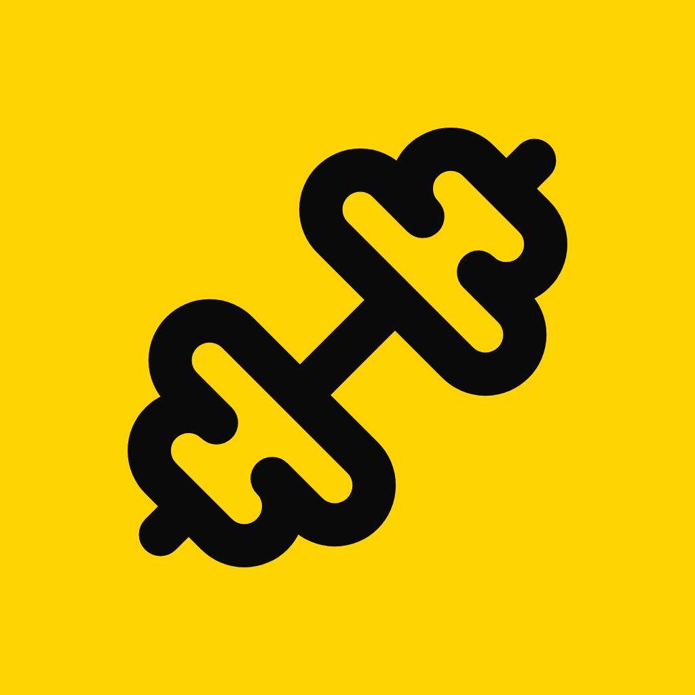

  

<h1 align="center">GymTracker</h1>

  <strong>A free, open-source workout log for strength training.</strong> 
  Fast, offline and entirely yours: no accounts, no cloud, no social feed.

  
  
  
  

  <a href="https://github.com/Hamelonov/GymTracker/releases/latest"><strong>Download the APK</strong></a>
  &nbsp;·&nbsp;
  <a href="#features">Features</a>
  &nbsp;·&nbsp;
  <a href="#how-to-install">How to install</a>
  &nbsp;·&nbsp;
  <a href="CONTRIBUTING.md">Contributing</a>

---

## Why GymTracker

|                  |                                                                                         |
| ---------------- | --------------------------------------------------------------------------------------- |
| **Private**      | Your workouts live in a database on your phone. No account, no analytics, no cloud.     |
| **Fast**         | Log a set with one tap. The last session's numbers are right there as a hint.           |
| **Complete**     | Routines, a 770+ exercise library, history, progress charts, records and body tracking. |
| **Yours to own** | Full JSON backup at any time, plus CSV and Excel export. Open source under GPL-3.0.     |

## Features

### Logging a workout

- Live workout timer, previous-performance hints and one-tap set completion
- Warm-up, drop and failure sets, supersets, and optional RIR and RPE
- Rest timer for every exercise with sound, vibration and a notification
- A clock sheet with a timer and a stopwatch right from the workout screen
- Two kinds of exercise text: a permanent **description** (how to perform the movement) and a per-session **note** (how it went today)
- Crash-safe autosave, so a closed app never loses a workout in progress
- Log a workout after the fact: pick the date, start time and duration

### Exercise library

- 770+ built-in exercises in English and Russian, each with a description and muscle diagram
- Search and muscle filters, plus your own custom exercises
- Per-exercise history, charts (heaviest weight, estimated 1RM, volume, reps) and personal records

### Routines

- Build routines with planned sets and use them to start a workout in one tap
- Duplicate a routine, update it from a finished workout, or save any workout as a new routine

### History and progress

- History as a **month** calendar, a **year** overview or a **list**; open any day to see what you did
- Edit or repeat any past workout
- A progress log that writes every exercise like a paper diary (`70 kg × 9/8/8`) with filters by exercise and period, and Excel export
- Statistics: weekly volume, workouts, time and sets, muscle split, streaks and top exercises
- Body measurements with charts

### Tools

- Plate calculator: which plates go on each side of the bar
- 1RM calculator with a percentage table
- Reps calculator for bodyweight exercises: a working-range set plan from your max reps

### Your data

- Full JSON backup that restores everything; importing merges data and never erases what you already have
- CSV and Excel export
- Import of workout history from CSV and Excel files, with the format detected automatically

### Make it yours

- Light, dark or system theme
- English and Russian interface
- kg / lb, km / mi, cm / in

## How to install

1. Open the [latest release](https://github.com/Hamelonov/GymTracker/releases/latest) on your phone.
2. Under **Assets**, tap the `GymTracker-….apk` file to download it.
3. Open the downloaded file. Android will ask whether to allow installing apps from this source (your browser or file manager). Allow it.
4. Tap **Install**. If Play Protect warns about an unknown app, choose **Install anyway**: the app is not on Google Play, so this is expected.

Requires Android 7.0 or newer.

## How to update

Download the APK from the new release and install it over the old one. Your workouts are kept.

To be safe, you can save a backup before updating: **Profile → Data → Export → Full backup (JSON)**.

## Privacy

GymTracker has no accounts, no analytics and no cloud sync. Your workouts never leave your phone. The only server the app talks to is Expo's update service, and only to check whether a newer version of the app is available.

## Built with

[React Native](https://reactnative.dev) and [Expo](https://expo.dev), TypeScript, SQLite with [Drizzle](https://orm.drizzle.team), Zustand and Expo Router. Android first; the code is written to be portable to iOS later.

Want to run the project or send a change? Read [CONTRIBUTING.md](CONTRIBUTING.md).

## License

GPL-3.0-only. See [LICENSE](LICENSE).
